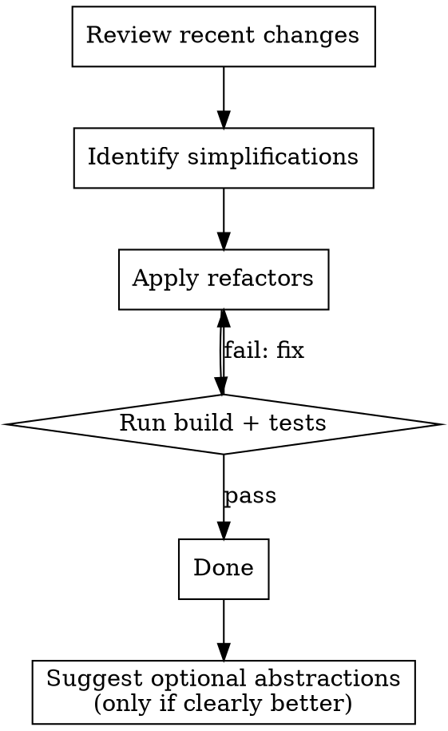

# Refactor Pass

Simplify recently changed code while preserving behavior. Every change must be verified by build/tests.

## When to Use

- After completing a feature or bugfix and wanting to clean up
- When code has dead paths, unused parameters, or over-abstraction
- When logic flows are tangled or harder to follow than necessary
- When the user says "refactor", "cleanup", "simplify", or "remove dead code"

## Workflow

1. **Review** recent changes (staged, unstaged, or last N commits as context dictates).
2. **Identify** simplification opportunities — look for:
   - Dead code and unreachable paths
   - Tangled logic that can be straightened
   - Excessive or unused parameters
   - Premature abstractions or optimizations
   - Redundant conditionals or duplicate expressions
3. **Apply** refactors incrementally. Each refactor should be a small, reviewable change.
4. **Verify** — run build and tests after each logical group of changes. If anything breaks, fix before continuing.
5. **Suggest** optional abstractions or reusable patterns only if they clearly improve clarity. Keep suggestions brief — one sentence each, no implementation unless asked.

## What This Is NOT

- Not a feature pass — do not add behavior.
- Not a style pass — do not reformat code that works fine.
- Not a renaming pass — only rename if a name is actively misleading.

## Common Mistakes

| Mistake | Fix |
|---------|-----|
| Refactoring code you didn't read first | Always read the file before editing |
| Removing code that looks dead but is used dynamically | Grep for usages before deleting |
| Combining too many changes before verifying | Verify after each logical group |
| "Improving" code beyond what was asked | Only simplify — don't add features or abstractions |
